<p align="center">
  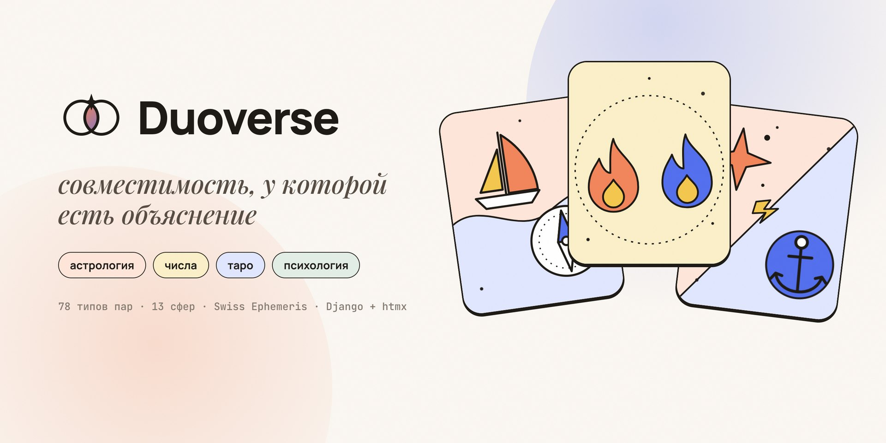
</p>

<p align="center">
  <a href="https://github.com/deuteriumZzz/Duoverse/actions/workflows/ci.yml"></a>
  
  
  
  
  
  
</p>

<p align="center">
  <b>Разбор пары в четырёх «вселенных»: астрология, числа, таро и психология.</b><br>
  Не «вы совместимы на 78 %», а что именно у вас хорошо, где будут ссоры и что с этим делать — простым языком.
</p>

<p align="center">
  <a href="#-демо">Демо</a> ·
  <a href="#-что-внутри">Что внутри</a> ·
  <a href="#-как-это-считается">Как это считается</a> ·
  <a href="#-быстрый-старт">Быстрый старт</a> ·
  <a href="#-деплой">Деплой</a> ·
  <a href="#-архитектура">Архитектура</a> ·
  <a href="#-документация">Документация</a>
</p>

---

## ✦ Демо

<table>
  <tr>
    <td width="34%" align="center">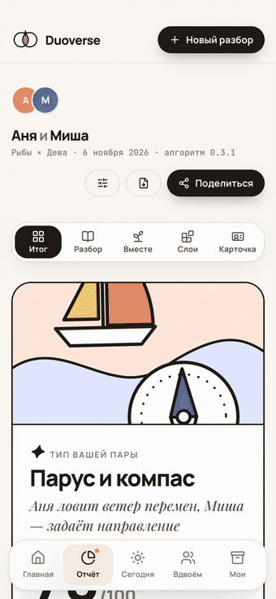</td>
    <td width="66%">
      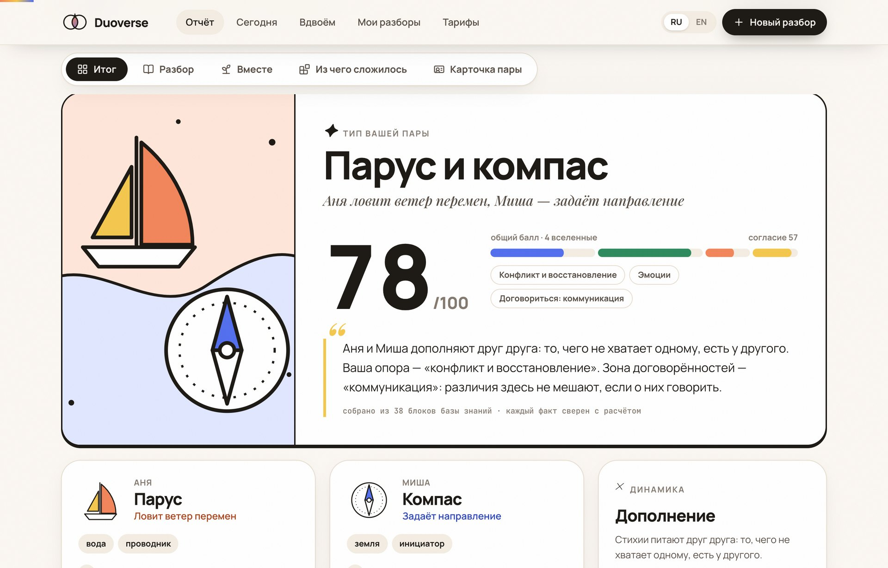
      <p align="center"><sub>Итог: один из 78 типов пар, балл по четырём вселенным и сводка, собранная из проверенных текстов</sub></p>
    </td>
  </tr>
</table>

<table>
  <tr>
    <td align="center">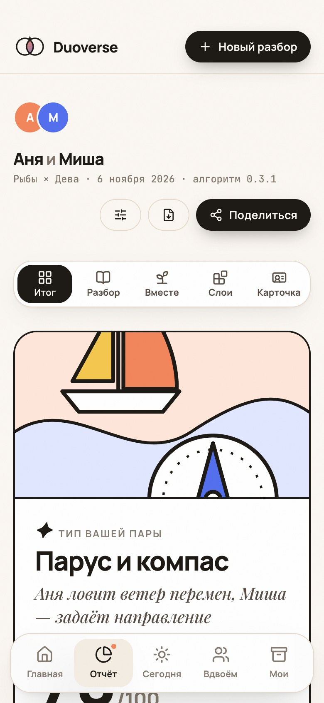<br><sub>Итог</sub></td>
    <td align="center">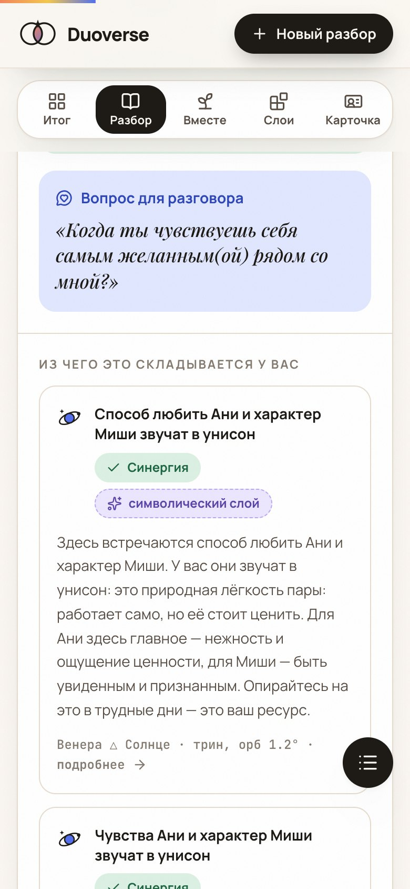<br><sub>Разбор по сферам</sub></td>
    <td align="center">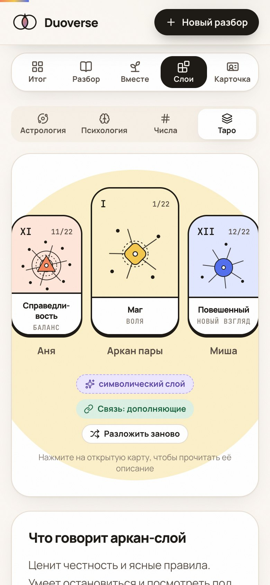<br><sub>Таро</sub></td>
    <td align="center">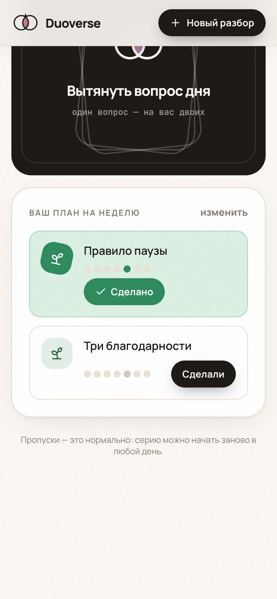<br><sub>План на неделю</sub></td>
  </tr>
  <tr>
    <td align="center">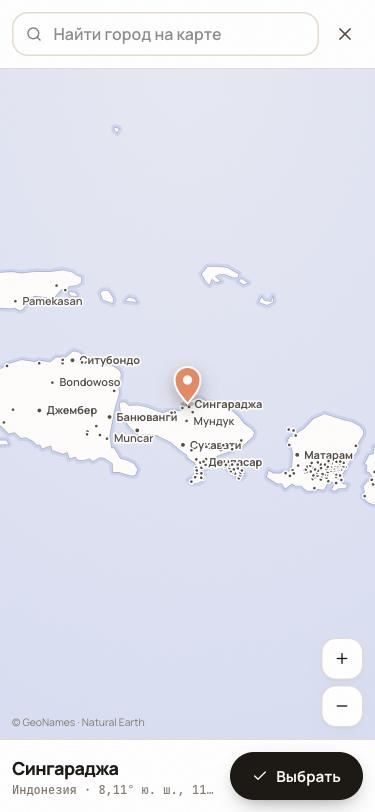<br><sub>Место рождения в любой точке мира</sub></td>
    <td align="center">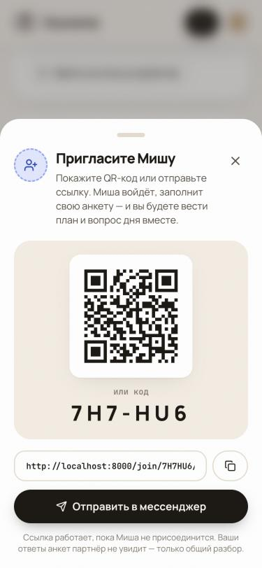<br><sub>Пригласить партнёра</sub></td>
    <td colspan="2" align="center">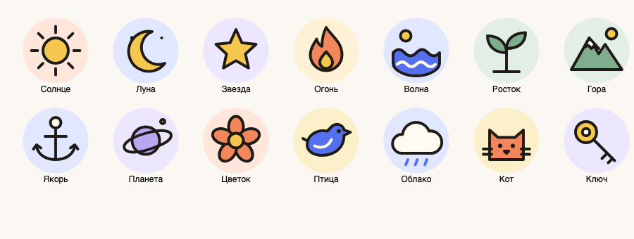<br><sub>Аватарки на выбор</sub></td>
  </tr>
</table>

<details>
<summary><b>Ещё экраны</b></summary>
<br>

| Лендинг | Две карты: биколесо и таблицы планет |
|---|---|
| 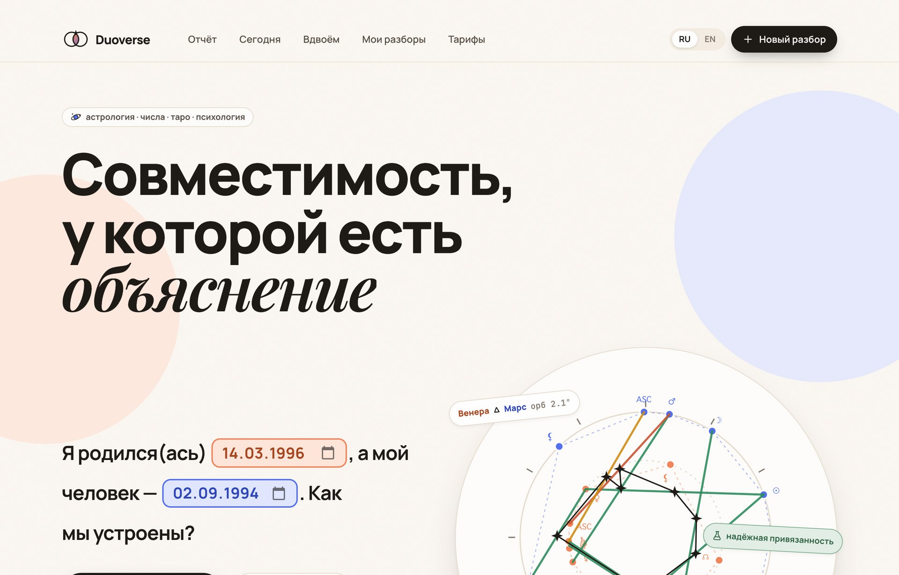 | 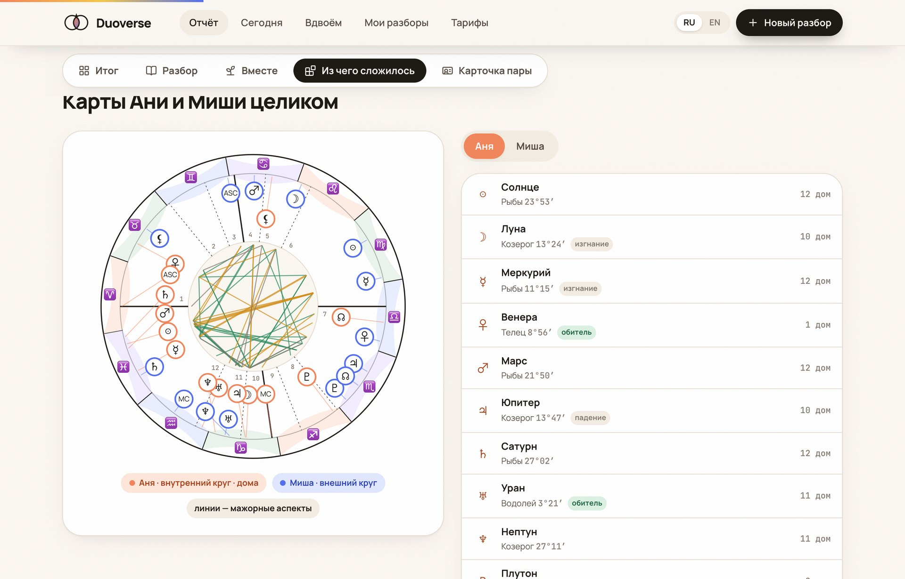 |
| **Из чего сложилось: четыре слоя** | **Карта мира в нашем стиле: реки, озёра, города** |
| 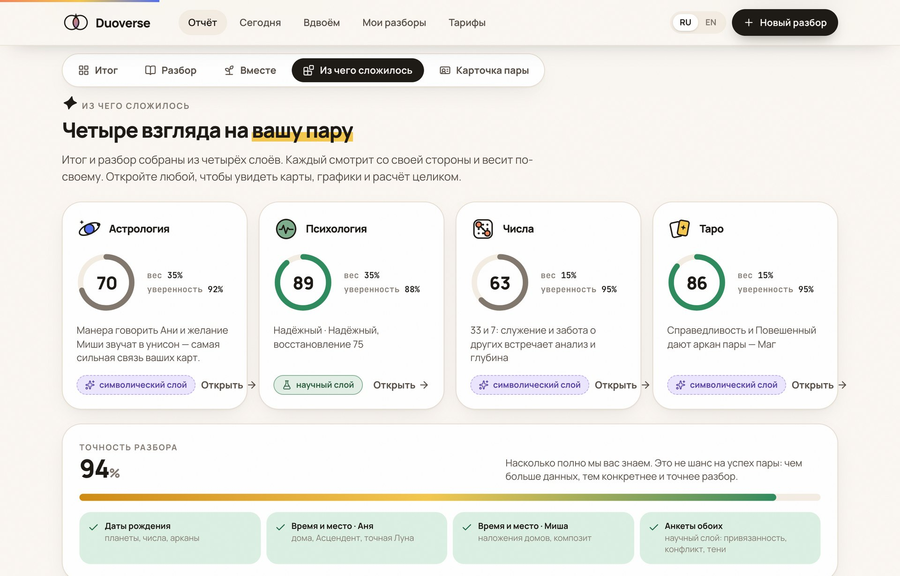 | 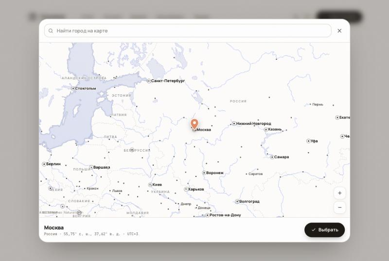 |
| **Профиль под аватаркой** | **Выбор аватарки** |
| 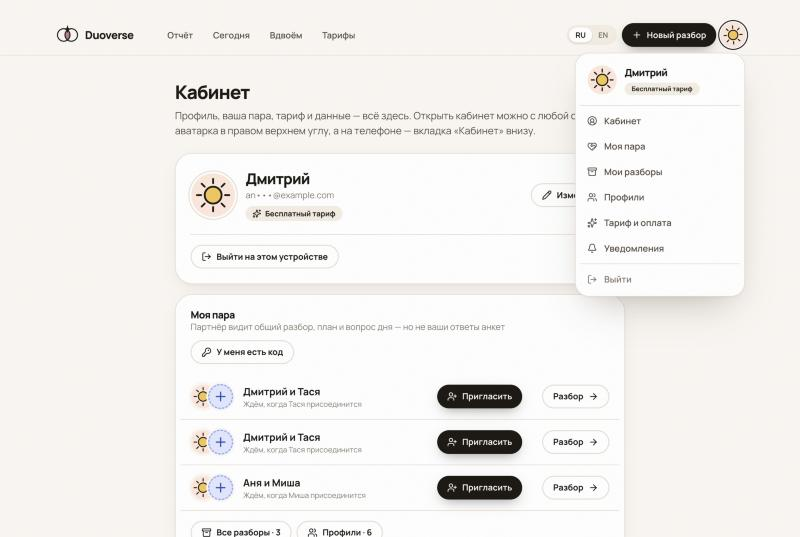 | 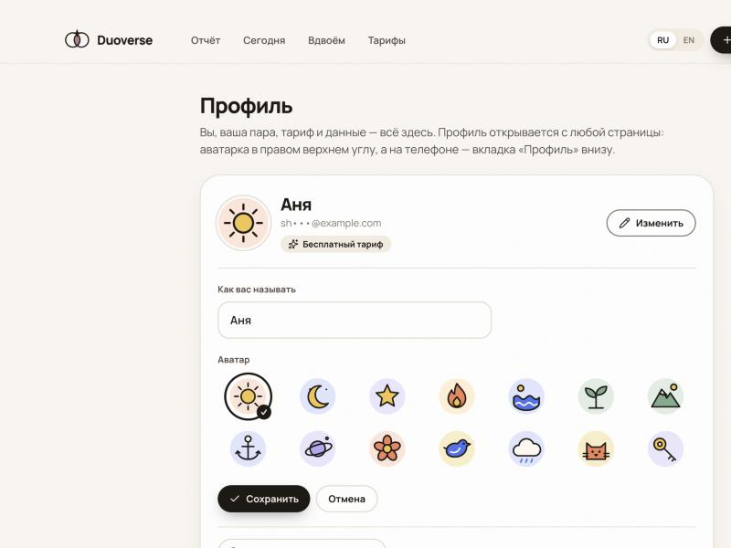 |
| **Вход панелью поверх расчёта** | **Календарь для даты рождения** |
| 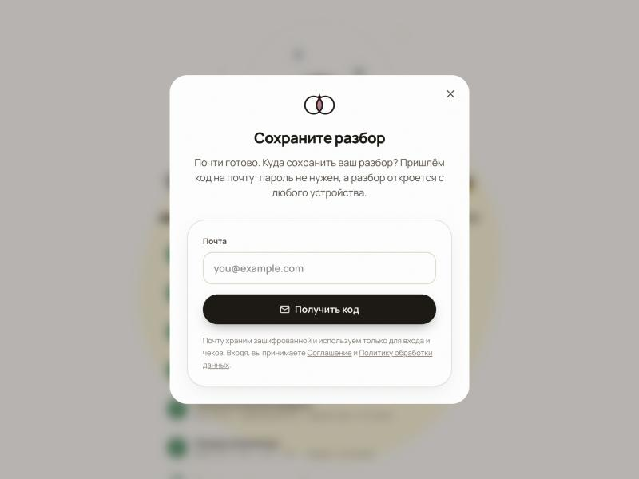 | 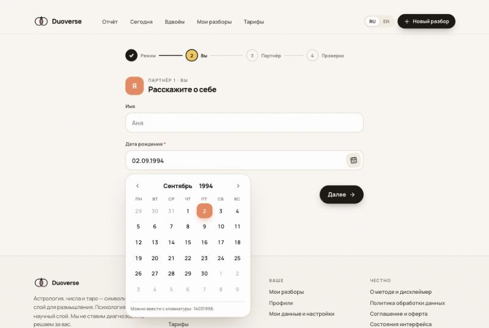 |

</details>

## ✦ Что внутри

**Для пары**

- **Итог за минуту.** Тип пары (12 ролей → 78 типов), балл, точность разбора и то, что её повысит.
- **Разбор по 13 сферам:** притяжение, секс (за подтверждением 18+), эмоции, разговоры, конфликты, доверие, власть, тени, дом, деньги, планы, люди, рост. В каждой сфере — история вашей пары, сценарий ссоры, упражнение, вопрос для разговора и факторы из всех слоёв.
- **Из чего сложилось.** Полные карты: биколесо, сетка аспектов (мажорные и минорные), наложение домов, композит, баланс стихий; Big Five, привязанность и стиль конфликта; числа и Матрица; арканы.
- **Сегодня — на двоих.** Вопрос дня (364 вопроса по 13 сферам, с упором на слабые сферы пары): каждый отвечает со своего телефона, ответ партнёра открывается, когда ответили оба. Квиз недели — сравните, где вы совпадаете. Уведомления в Telegram или на почту.
- **Вместе.** Микропривычки, выросшие из слабых сфер пары. Пара берёт 2–3 на неделю кнопкой «В план». Трекер общий, но каждый отмечает свою часть: рядом с кнопкой видно, сделал ли уже партнёр.
- **Место рождения — где угодно на Земле.** Поиск по 237 тыс. населённых пунктов (GeoNames, 76 тыс. с русскими названиями) в любом написании: «Сингараджа» = «Singaraja». Или точка на нашей карте: контуры Natural Earth, реки, озёра, подписи стран и городов, булавка цвета партнёра. Координаты и часовой пояс идут в расчёт домов и Асцендента. Даты — с маской ввода или в календаре, который открывается сразу на годах.
- **Профиль и пара.** Аватарка справа вверху (на телефоне — вкладка «Профиль») открывает меню: пара, разборы, сохранённые люди, тариф, уведомления. 14 аватарок на выбор. Пока партнёр не присоединился, рядом с вашей аватаркой «+»: QR-код, код из 6 символов и ссылка с кнопкой «Отправить в мессенджер». Партнёр видит только эту пару — общий разбор, план и вопрос дня, но не ваши ответы анкет.
- **Тарифы.** Итог, первая сфера, план, вопрос дня и приглашение партнёра бесплатно. Глубокий разбор — 490 ₽ разово, открывается обоим: все сферы, слои с картами и графиками, PDF. «Пара+» — 249 ₽ на 30 дней без автосписаний: все пары целиком, квизы, история ответов, действует и для партнёра. Оплата через ЮKassa с чеком по 54-ФЗ.
- **Вход без пароля и без отдельной регистрации.** Попробовать можно без аккаунта. Когда нужно сохранить разбор, пригласить партнёра или оплатить, поверх страницы выезжает панель: почта → код из 6 цифр → готово (или Яндекс ID, VK ID, Telegram). Разборы с устройства переезжают в аккаунт; устройства, выгрузка и удаление данных — в «Профиле».

**Для разработчика**

- Каждое число в отчёте посчитано: Swiss Ephemeris, пифагорейская нумерология с мастер-числами, редукция арканов, психометрические шкалы, движок весов. Отчёт — снимок, привязанный к версии алгоритма.
- Тексты — из базы знаний с модерацией (`draft → reviewed → published`). ИИ (Claude) только сшивает проверенные блоки, а пост-валидатор отклоняет ответ с выдуманными планетами и аспектами. Без ключа API отчёт собирается из блоков без ИИ.
- Чистая архитектура: расчёты — чистые функции в `domain/`, сборка — в `application/`, Django — только снаружи.
- Ни одного стороннего запроса со страниц: шрифты, карта, справочник мест и библиотеки лежат на нашем сервере. Имена партнёров не уходят в Claude — вместо них метки, которые подставляются обратно у нас.

## ✦ Как это считается

| Вселенная | Слой | Вес | Что даёт |
|---|---|---|---|
| Астрология | символический | 35 % | синастрия, наложение домов, композит |
| Психология | научный | 35 % | Big Five (Mini-IPIP), привязанность, конфликт (по Готтману) |
| Числа | символический | 15 % | жизненный путь, число пары, Матрица |
| Таро | символический | 15 % | арканы рождения и аркан пары |

- **Нет слоя — его вес делится между остальными.** Человек может поменять веса сам («не верю в таро»).
- **Индекс согласия** показывает, насколько вселенные сходятся между собой: высокий балл при низком согласии — повод для осторожности.
- **Точность разбора зависит от данных:** только даты → + время и место рождения (дома, Асцендент, точная Луна) → + анкеты обоих (научный слой). Точность — это то, насколько полно мы знаем пару, а не вероятность её успеха.
- **Этика.** Никаких вердиктов, прогнозов и диагнозов; символический слой честно подписан как символический. Методика каждой вселенной описана в [`docs/methodology/`](docs/methodology).

## ✦ Быстрый старт

Нужны Python 3.12, Node 22 и [uv](https://docs.astral.sh/uv/).

```bash
git clone https://github.com/deuteriumZzz/Duoverse.git && cd Duoverse
uv venv --python 3.12 .venv && uv pip install --python .venv -r pyproject.toml --group dev
npm install && npm run build           # иконки + Tailwind → static/dist/app.css
cp .env.example .env                   # ANTHROPIC_API_KEY — по желанию
.venv/bin/python manage.py migrate     # база + сид базы знаний
.venv/bin/python manage.py places_load # места рождения: скачает GeoNames (~14 МБ), ~1 мин
.venv/bin/python manage.py runserver   # → http://localhost:8000
```

С Postgres, Redis и Celery: `docker compose up`.

| Команда | Что делает |
|---|---|
| `npm run watch` | пересборка CSS при правках шаблонов |
| `.venv/bin/python -m pytest` | тесты: расчёты, сборка отчёта, сценарии от мастера до удаления данных |
| `.venv/bin/python manage.py kb_coverage` | каких текстов не хватает в базе знаний |
| `.venv/bin/python manage.py kb_draft --dry-run` | сколько черновиков допишет Claude (пакетный режим API, нужен `ANTHROPIC_API_KEY`); без `--dry-run` — пишет их со статусом «черновик» для проверки в `/staff/` |
| `.venv/bin/python manage.py createsuperuser` | доступ к админке базы знаний `/staff/` |
| `.venv/bin/python manage.py places_load` | загрузить или обновить справочник мест (GeoNames cities500 + русские названия из репозитория) |
| `npm run geo -- <папка>` | пересобрать слои карты из архивов Natural Earth 1:10 млн (`scripts/build_geo.sh`) |

В режиме разработки письма с кодом входа не уходят, а печатаются в консоль сервера.

Демо-отчёт открыт на `/report/`. Сценарии (идеальная и сложная пара, нет времени рождения, нет анкет, только даты, ошибка) переключаются скрытой плашкой: `?dev=1` включает её, `?dev=0` выключает (только при `DEBUG`).

## ✦ Деплой

Один образ, который сам отдаёт статику, плюс Postgres, Redis и Celery-воркер. Для одного сервера есть готовый compose с автоматическим HTTPS (Caddy):

```bash
cp .env.example .env    # заполните блок «production»
docker compose -f docker-compose.prod.yml up -d --build
```

Пошагово, включая PaaS, бэкапы и чек-лист перед запуском: [**docs/DEPLOY.md**](docs/DEPLOY.md).

## ✦ Архитектура

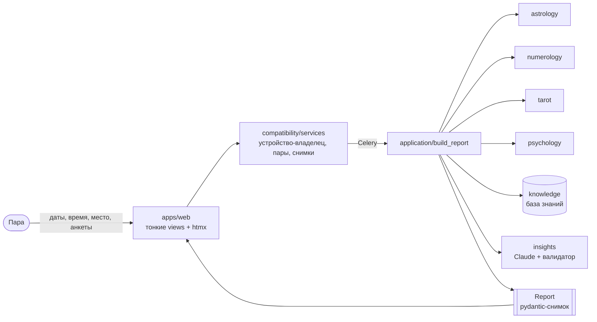

| Путь | Что |
|---|---|
| `apps/compatibility/domain/report.py` | контракт отчёта (pydantic) |
| `apps/compatibility/application/build_report.py` | сборка отчёта из расчётов и базы знаний |
| `apps/{astrology,numerology,tarot,psychology}/domain/` | расчёты вселенных — чистые функции |
| `apps/compatibility/models.py`, `services.py`, `tasks.py`, `plan.py` | аккаунты и устройства, пары, снимки, подписанные ссылки, Celery, общий план с отметками каждого |
| `apps/compatibility/places.py`, `data/places_ru.tsv.gz` | места рождения: поиск в любом написании, ближайшее место к точке, города в окне карты |
| `apps/compatibility/access.py`, `infrastructure/yookassa.py` | что открыто на каком тарифе, оплата и чеки |
| `apps/knowledge/` | база знаний, сид, `kb_coverage` |
| `apps/insights/` | ИИ-сшивка: промпт, вызов Claude, валидатор |
| `apps/web/` | views, URL, template tags (иконки, радар, биколесо, постеры пар), аватарки (`avatars.py`) |
| `static/js/app.js` | календарь даты, поле места и карта мира (d3), анимации |
| `static/vendor/geo/` | контуры Natural Earth 1:50 млн и 1:10 млн, подписи стран |
| `templates/components/` | компоненты интерфейса, один компонент — один файл |
| `static/src/app.css` | дизайн-токены и motion-система |

**Стек:** Django 5.2 · htmx 2 · Alpine.js 3 · Tailwind CSS 4 · d3 7 · pydantic 2 · Celery + Redis · PostgreSQL · pyswisseph · Anthropic SDK · ЮKassa · WhiteNoise · gunicorn · Docker · GitHub Actions (ruff, mypy, pytest, сборка образа).

## ✦ Документация

| Документ | О чём |
|---|---|
| [`docs/methodology/`](docs/methodology) | как считается каждая вселенная и типы пар |
| [`docs/product/REPORT_SPEC.md`](docs/product/REPORT_SPEC.md) | что и зачем есть в отчёте |
| [`docs/ui/SCREEN_MAP.md`](docs/ui/SCREEN_MAP.md) | карта экранов и состояний |
| [`docs/design/DESIGN_SYSTEM.md`](docs/design/DESIGN_SYSTEM.md) | дизайн-система и motion |
| [`docs/contracts/report.md`](docs/contracts/report.md) | контракт данных отчёта |
| [`docs/adr/`](docs/adr) | архитектурные решения |
| [`docs/DEPLOY.md`](docs/DEPLOY.md) | деплой, места рождения, бэкапы |
| [`docs/legal/`](docs/legal) | черновики политики, согласия и оферты (152-ФЗ) и чек-лист запуска |

## ✦ Приватность

Дата, время и место рождения, ответы анкет и почта шифруются в базе (Fernet); для поиска аккаунта хранится только ключевой хэш почты. Вход без паролей, каждое устройство можно отключить. Партнёр видит общий разбор пары, но не ваши ответы анкеты и не другие разборы. Данные можно выгрузить и удалить одной кнопкой в «Профиле»; ссылки «поделиться» показывают только карточку пары. Без аккаунта данные удаляются через 7 дней.

Страницы `/privacy/`, `/consent/`, `/terms/` собираются из черновиков в [`docs/legal/`](docs/legal); согласие 18+ спрашивается в мастере и при присоединении партнёра. Шрифты, карта и справочник мест отдаются нашим сервером, так что браузер не обращается к сторонним сервисам; в Claude API имена не передаются. Подробнее: [ADR-0010](docs/adr/0010-accounts-and-pairs.md).

## ✦ Лицензии

Астрономические расчёты используют [Swiss Ephemeris](https://www.astro.com/swisseph/) через `pyswisseph`: AGPL или коммерческая лицензия Astrodienst. Места — [GeoNames](https://www.geonames.org/) (CC BY 4.0), контуры карты — [Natural Earth](https://www.naturalearthdata.com/) (общественное достояние), отрисовка — [d3](https://d3js.org/) (ISC). Лицензию самого проекта выбирает владелец репозитория.

<p align="center"><sub>Астрология, числа и таро — символический слой для размышления, не наука. Психология опирается на исследования. Duoverse не ставит диагнозов и не принимает решений за вас.</sub></p>
